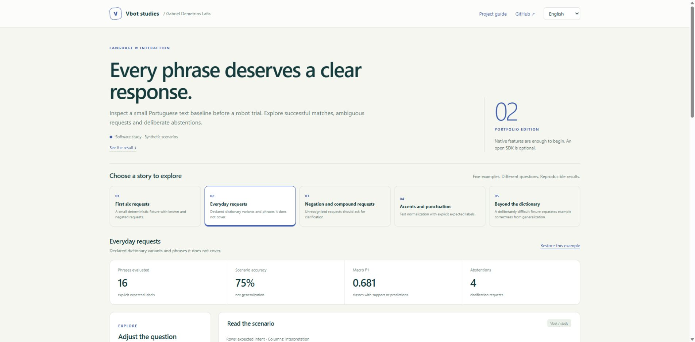
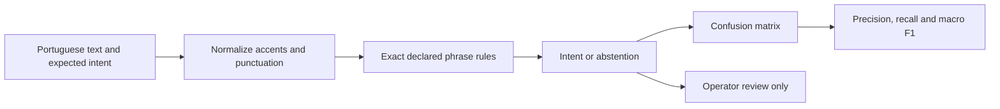

<p align="center"></p>

<h1 align="center">Portuguese Interaction Bench</h1>

<p align="center"><strong>Every phrase deserves a clear response.</strong><br>Cada frase merece uma resposta clara.</p>

<p align="center">
<a href="https://github.com/galafis/vbot-ptbr-interaction-bench/actions/workflows/checks.yml"></a>


</p>

<p align="center"><a href="https://galafis.github.io/vbot-ptbr-interaction-bench/?lang=en"><strong>Open the interactive study</strong></a> · <a href="https://galafis.github.io/vbot-ptbr-interaction-bench/?lang=pt"><strong>Abrir estudo em português</strong></a> · <a href="docs/DEMO.md">Guided walkthrough</a> · <a href="docs/EXPERIMENTS.md">Reproduce the examples</a></p>

[](https://galafis.github.io/vbot-ptbr-interaction-bench/?lang=en&example=everyday-requests)

[English](#english) · [Português](#português)

## English

Inspect a small Portuguese text baseline before a robot trial. Explore successful matches, ambiguous requests and deliberate abstentions.

**Research question:** Which phrases does an explicit dictionary understand, and where does it abstain?

This is a working, independent software study for a proposed Vbot companion-robotics program. You can run every example without a robot, account, package installation or API key. Physical validation has not been performed.

### Explore in one minute

1. [Open **Everyday requests**](https://galafis.github.io/vbot-ptbr-interaction-bench/?lang=en&example=everyday-requests).
2. Inspect the chart and the explanation below it. The starting result is **12/16 correct · 4 abstentions**.
3. Adjust a control or select a contrasting example. Download a printable HTML report, a CSV evidence table or the full JSON analysis.

[View a portable example report](https://galafis.github.io/vbot-ptbr-interaction-bench/examples/sample-report.html).

The JSON editor is available under **Advanced**; the main study uses guided controls.

### What you can investigate

- A deliberately small, inspectable Portuguese phrase dictionary and full-string matching.
- A live text sandbox that explains the operator's next step without issuing commands.
- A confusion matrix, per-intent precision/recall/F1 and supported-class macro F1.
- Known phrases, normalization, negation/compound cases and a difficult held-out fixture.
- Visible abstentions and errors, including examples where the dictionary performs poorly.

All five studies include a responsive English/Portuguese interface, keyboard focus styles, synthetic narrated examples and local report exports. Analysis runs in your browser after the page loads.

### Five examples, five questions

| Example                                                                                                                         | Question it exposes                                                                 | Reproducible core result      |
| ------------------------------------------------------------------------------------------------------------------------------- | ----------------------------------------------------------------------------------- | ----------------------------- |
| [First six requests](https://galafis.github.io/vbot-ptbr-interaction-bench/?lang=en&example=baseline)                           | A small deterministic fixture with known and negated requests.                      | 6/6 correct · 2 abstentions   |
| [Everyday requests](https://galafis.github.io/vbot-ptbr-interaction-bench/?lang=en&example=everyday-requests)                   | Declared dictionary variants and phrases it does not cover.                         | 12/16 correct · 4 abstentions |
| [Negation and compound requests](https://galafis.github.io/vbot-ptbr-interaction-bench/?lang=en&example=negation-and-compounds) | Unrecognized requests should ask for clarification.                                 | 9/10 correct · 8 abstentions  |
| [Accents and punctuation](https://galafis.github.io/vbot-ptbr-interaction-bench/?lang=en&example=normalization)                 | Test normalization with explicit expected labels.                                   | 9/10 correct · 2 abstentions  |
| [Beyond the dictionary](https://galafis.github.io/vbot-ptbr-interaction-bench/?lang=en&example=held-out-phrases)                | A deliberately difficult fixture separates example correctness from generalization. | 2/10 correct · 10 abstentions |

These are deterministic scenario results, not field measurements. [Experiment notes](docs/EXPERIMENTS.md) distinguish expected regression outputs from independent arithmetic and failure-case tests.

### Run locally

Install Node.js 22 or newer. No npm dependencies are required.

```sh
git clone https://github.com/galafis/vbot-ptbr-interaction-bench.git
cd vbot-ptbr-interaction-bench
npm run serve
```

Open **http://127.0.0.1:8765**. The local server binds to your computer only. Stop with Ctrl+C. For another port, use `node server.mjs 8766`.

```sh
npm run check                                  # syntax, domain tests, examples and server checks
node cli.mjs examples/everyday-requests.json            # core analysis
node study.mjs examples/everyday-requests.json          # analysis plus derived insights
node cli.mjs examples/baseline.json new-result.json
```

The CLI refuses to overwrite an existing output file. Exit 1 means invalid input or an I/O failure; review findings are valid analytical outputs and do not change the exit code.

### How the study works



**Method:** Exact phrase rules, a confusion matrix and per-intent precision/recall. The core engine and the insight layer are pure local calculations shared by browser and CLI. [Architecture](docs/ARCHITECTURE.md) · [Domain method](docs/METHOD.md) · [Input contract](docs/DATA_CONTRACT.md).

### Evidence and scope

| Evidence available now                                                         | Next evidence needed                                                  |
| ------------------------------------------------------------------------------ | --------------------------------------------------------------------- |
| 19 automated tests, five reproducible fixtures and a real interface screenshot | Measurements from a specific supplied Vbot unit                       |
| Deterministic calculations and explicit counterexamples                        | Repeated permitted exercises with operator observations               |
| Bilingual methods, reports and example inputs                                  | Appropriate authorization before institutional or participant studies |

**A standard Vbot without an open SDK is welcome.** The proposed first hardware stage uses native features, the official app and manual observations. Any later programmatic integration is optional and must be permitted by the manufacturer. [Native workflow](docs/VBOT_WORKFLOW.md) · [90-day study plan](docs/STUDY_PLAN.md).

### Project map

```text
src/        Pure domain engine, contracts and derived insights
examples/   Five narrated inputs and reproducible expected outputs
app.mjs     Guided bilingual browser workbench
styles.css  Responsive, printable visual system
cli.mjs     Core analysis from a local JSON file
study.mjs   Complete study from a local JSON file
tests/      Domain, insight, reproduction and HTTP checks
docs/       Walkthrough, experiments, method and study plan
```

## Português

Examine uma baseline textual em português antes de um ensaio com o robô. Explore acertos, pedidos ambíguos e abstenções deliberadas.

**Pergunta do estudo:** Quais frases um dicionário explícito reconhece e quando ele se abstém?

O projeto está pronto para exploração em software. Os exemplos são fictícios e a validação física ainda depende de uma unidade. Uma unidade comum, sem SDK aberto, é suficiente para iniciar a fase proposta com recursos nativos e observação manual.

### Comece por um exemplo concreto

[Abra **Pedidos do cotidiano**](https://galafis.github.io/vbot-ptbr-interaction-bench/?lang=pt&example=everyday-requests). O resultado inicial é **12/16 acertos · 4 abstenções**. Observe o gráfico, mude um parâmetro ou escolha outro cenário. A interface explica os resultados e exporta relatório HTML imprimível, tabela CSV e análise JSON.

### Funcionalidades

- Dicionário pequeno e inspecionável de frases em português, com correspondência integral.
- Teste de frases na interface, com explicação da próxima ação do operador.
- Matriz de confusão, precisão/recall/F1 por intenção e macro F1 das classes com suporte ou previsão.
- Casos conhecidos, normalização, negação e frases difíceis fora do dicionário.
- Abstenções e erros ficam visíveis, inclusive quando o desempenho é baixo.

### Exemplos disponíveis

| Exemplo                                                                                                                      | O que permite examinar                                                                     | Resultado reproduzível       |
| ---------------------------------------------------------------------------------------------------------------------------- | ------------------------------------------------------------------------------------------ | ---------------------------- |
| [Primeiros seis pedidos](https://galafis.github.io/vbot-ptbr-interaction-bench/?lang=pt&example=baseline)                    | Uma pequena verificação determinística com pedidos conhecidos e negados.                   | 6/6 acertos · 2 abstenções   |
| [Pedidos do cotidiano](https://galafis.github.io/vbot-ptbr-interaction-bench/?lang=pt&example=everyday-requests)             | Variações previstas no dicionário e frases que ele ainda não cobre.                        | 12/16 acertos · 4 abstenções |
| [Negação e pedidos compostos](https://galafis.github.io/vbot-ptbr-interaction-bench/?lang=pt&example=negation-and-compounds) | Pedidos não reconhecidos devem pedir esclarecimento.                                       | 9/10 acertos · 8 abstenções  |
| [Acentos e pontuação](https://galafis.github.io/vbot-ptbr-interaction-bench/?lang=pt&example=normalization)                  | Teste a normalização mantendo os rótulos esperados explícitos.                             | 9/10 acertos · 2 abstenções  |
| [Fora do dicionário](https://galafis.github.io/vbot-ptbr-interaction-bench/?lang=pt&example=held-out-phrases)                | Uma avaliação deliberadamente difícil evita confundir acerto no exemplo com generalização. | 2/10 acertos · 10 abstenções |

### Executar e contribuir

Use os comandos da seção em inglês com Node.js 22 ou superior. Não é necessário instalar pacotes. `npm run check` executa verificações de sintaxe, testes e reprodução dos cenários. O guia [DEMO](docs/DEMO.md) explica um percurso de exploração; [EXPERIMENTS](docs/EXPERIMENTS.md) registra os resultados e suas limitações.

Sugestões úteis incluem novos cenários fictícios, cálculos independentes, melhorias de acessibilidade da interface e protocolos de observação autorizados. Veja [CONTRIBUTING](CONTRIBUTING.md).

## Study collection · Coleção de estudos

[01 · Companion Follow Lab](https://github.com/galafis/vbot-accessible-follow-lab) · [02 · Portuguese Interaction Bench](https://github.com/galafis/vbot-ptbr-interaction-bench) · [03 · Community Cargo Planner](https://github.com/galafis/vbot-community-cargo-planner) · [04 · Inclusive Encounter Kit](https://github.com/galafis/vbot-inclusive-encounter-kit) · [05 · Community Observation Lab](https://github.com/galafis/vbot-community-observation-lab)

---

Created by **[Gabriel Demetrios Lafis](https://www.linkedin.com/in/gabriel-demetrios-lafis/)** · [Applied AI and robotics portfolio](https://github.com/galafis#robotics)

MIT-licensed independent work. Vbot is a third-party brand; this is not an official SDK or an announced Vbot/USP partnership.
