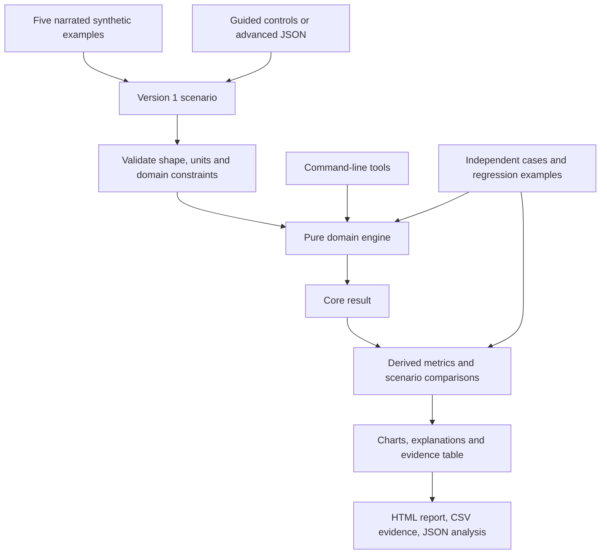

# Architecture / Arquitetura

The browser and command-line tools use the same deterministic domain implementation. A separate insight layer adds comparisons without changing the version 1 core output.

## Responsibilities

- src/engine.mjs: domain rules and version 1 core output.
- src/contract.mjs: shared strict primitives.
- src/insights.mjs: summaries and explicit counterfactual calculations.
- app.mjs: bilingual presentation and local interaction.
- styles.css: responsive layout, keyboard focus and printable presentation.
- examples/: five inputs, narrated catalog and reproducible golden outputs.
- server.mjs: dependency-free localhost server with an explicit public path set.
- cli.mjs / study.mjs: core and complete JSON analysis.

## Data flow and deployment

After loading, analysis runs entirely in the browser. There are no analytics, remote models, backend databases, credentials or robot commands. The public demo is a static copy served by GitHub Pages; visiting it makes normal hosting requests to GitHub. The local server binds to 127.0.0.1, supports GET/HEAD and serves only known assets/examples/docs.

JSON and HTML exports contain calculated results. CSV exports use quoted cells and neutralize leading spreadsheet formula characters. The printed HTML report has no external assets or scripts.

## Extending the work

Add a case to the catalog, document the question it tests, provide an expected result and add independently derived checks when changing the algorithm. Preserve compatibility with core outputs. Native Vbot observation remains the first proposed hardware stage; any authorized device adapter would be a separate module and evidence category.

## Português

O navegador e a linha de comando compartilham o motor de domínio. A camada de análises acrescenta comparações sem mudar a saída principal. O processamento é local após carregar a página. O servidor publica apenas arquivos conhecidos e aceita leitura. Relatórios são portáteis; integrações com o robô continuam opcionais e separadas.
